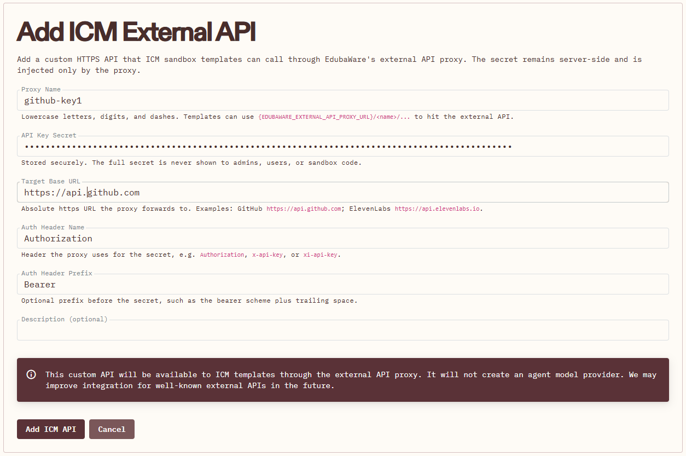

# Setting Up GitHub Access for an Umbrella ICM

This guide describes the GitHub integration this umbrella ICM uses on
EdubaWare. The package includes `workflow/.how-to-setup/configure-git.sh`, and
the runtime `CLAUDE.md` tells Claude when to run it. Nobody runs it by hand.

## Security Note

Alpha testing: people within your organization may convince an agent to act
maliciously toward a connected repository. Every ICM deployment in the
organization can use the key, so use narrow repository access and token
expiration.

## Prerequisites

- EdubaWare organization admin access
- A GitHub repository for the workflow to read or update (can be private)
- An ICM workflow containing its own context and stage contracts (like this repo)

## Step 1: Create GitHub Personal Access Token (PAT)

1. Go to https://github.com/settings/personal-access-tokens/new
2. Create a fine-grained token:
   - Repository access: "Only select repositories", only those the workflow needs
   - Expiration: 90 days (or as needed)
   - Repository permissions:
     - Contents: Read-only for reference inputs; Read and write when the
       workflow publishes artifacts (this umbrella does, in stage 3)
     - Metadata: Read-only
3. Save the token securely; GitHub shows it once.

## Step 2: Register External API Key in EdubaWare

In **Organization Admin → ICM → External APIs → Add ICM External API**
(`/Organizations/Admin/{OrgId}/Icm/ExternalApis/Create`):

- Proxy Name: `github-key1` (lowercase letters, digits, dashes; must match
  `ICM_GITHUB_API_KEY_NAME` in `workflow/CLAUDE.md`)
- API Key Secret: the PAT from Step 1
- Target Base URL: `https://api.github.com`
- Auth Header Name: `Authorization`
- Auth Header Prefix: `Bearer ` (with trailing space)



Keys saved here have ICM proxy access, and EdubaWare grants them to every
non-archived deployment in the organization automatically. There is no
per-template key setting.

Git traffic through the proxy goes to `github.com` and authenticates with the
PAT server-side. The sandbox only holds a session token that works only while a
turn is running.

## Step 3: Configure the Umbrella

Set the repository values in the runtime `CLAUDE.md` (`workflow/CLAUDE.md`):

```bash
export ICM_GITHUB_OWNER="<github-owner>"
export ICM_GITHUB_REPOSITORY="<repository-name>"
export ICM_GITHUB_BRANCH="main"
export ICM_GITHUB_CHECKOUT_DIR="<local-checkout-path>"
export ICM_GITHUB_API_KEY_NAME="<proxy-name>"
bash .how-to-setup/configure-git.sh
```

These values are configuration, not secrets. Keep the shared script; do not
replace it with a workflow-specific one. It runs as many times as needed:
workbench files persist between turns but `.git` does not, so each run
shallow-clones to a temporary folder and resets the checkout to the remote
branch. Approved changes are published in the same turn with
`configure-git.sh publish "<message>" <path>...`.

## Step 4: Upload the ICM Template

1. Build the archive from the `workflow/` package root only:

   ```bash
   git archive --format=zip --output=web-application-feedback.zip HEAD:workflow
   ```

   Nothing else may sit at the zip root beside the package files (for example
   `icm.yaml` or `__MACOSX/`), or EdubaWare will not find the entry file at the
   working directory root.
2. Upload the ZIP in Studio. A ZIP with an existing template name adds a version.
3. Create or update a deployment to use the new version. Existing workbenches
   stay on the version they started with; in a "One Workbench" (Single)
   deployment, replace the workbench to pick up a new version. Agent-written
   files such as `feedback/` are not carried over, so export them first.

## Step 5: Test

1. Start a chat in a new workbench. Confirm Claude runs
   `.how-to-setup/configure-git.sh` before replying and reports the checked-out
   commit.
2. Start a second chat on the same workbench, or wait for the container to
   recycle. Confirm the script refreshes the existing `EdubaWareVision/` folder
   without "already exists and is not an empty directory".
3. Run a harmless stage 3 test that publishes only to a test branch or test
   repository.

## Troubleshooting

- `404 No external API key named '...'`: the key name is wrong, or the key has
  no secret.
- `409` or `403` from the proxy: the session token is only valid during a
  running turn; rerun the script in the current turn.
- Authentication failed from GitHub: the PAT expired or cannot access the
  repository. Update the key's secret.
- Missing variable: add the `ICM_GITHUB_*` export to the runtime `CLAUDE.md`.
- Push rejected: the branch moved upstream. Rerun the refresh, reapply the
  change, and publish again.
